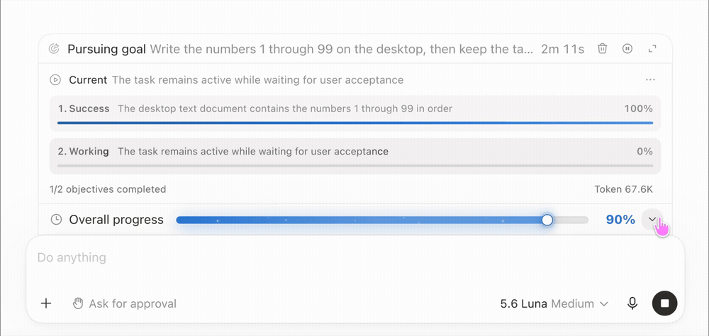
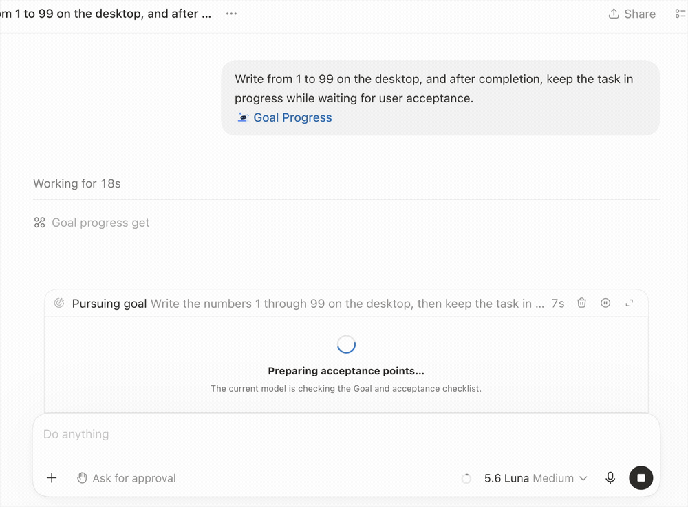
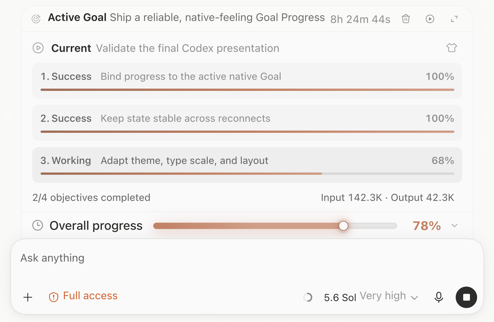
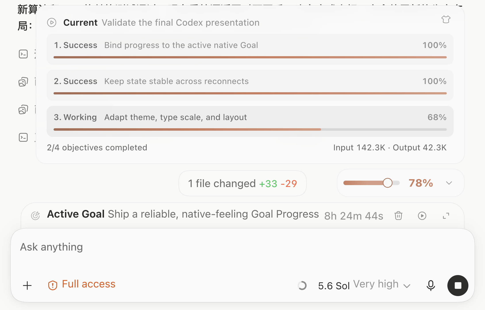
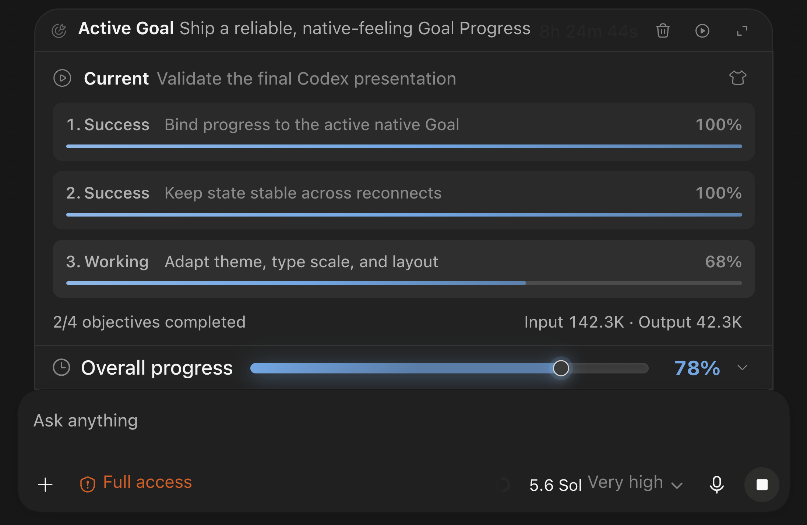
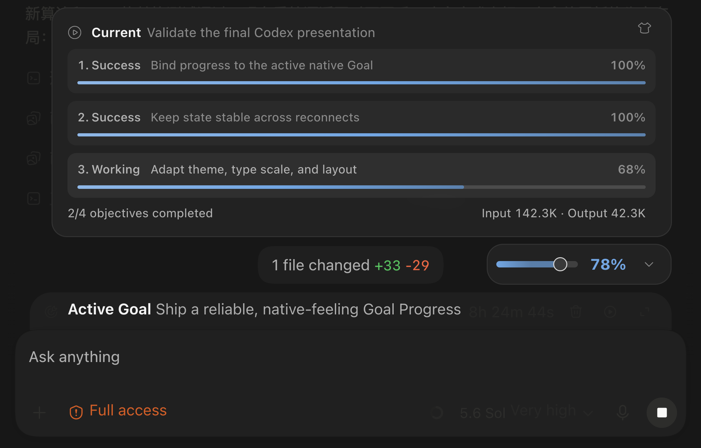
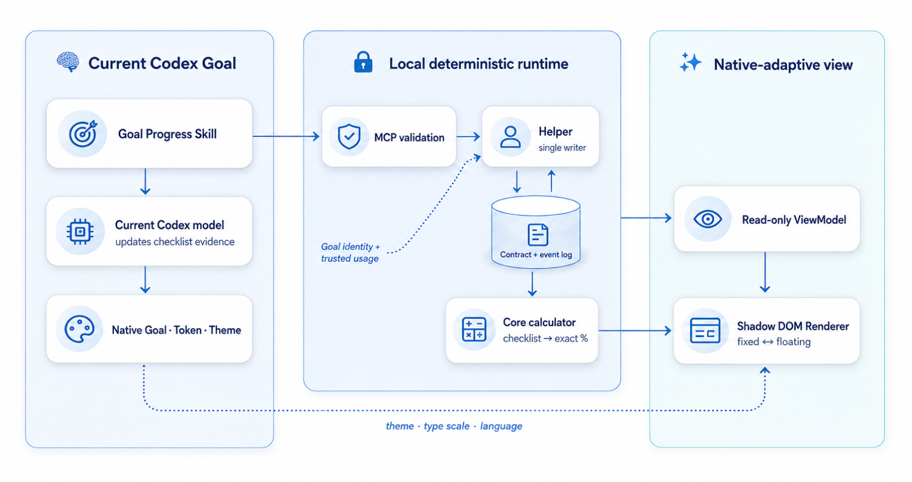

<div align="center">
  <h1 align="center">
    <br>
    Codex Goal Progress
  </h1>
  <p>A native progress bar for Codex Goals — see what is done, what is running now, and what comes next.</p>
  <p>
    <strong>English</strong> ·
    <a href="https://github.com/Ezra-Y/codex-goal-progress/blob/main/README.zh-CN.md">简体中文</a>
  </p>
</div>

<p align="center">
  
</p>

## ✨ Overview

Codex Goal Progress adds a live progress card right beside native Codex Goals so you can follow long tasks at a glance.

| Capability | What you get |
|---|---|
| Step-by-step and overall progress | Breaks a Goal into clear checklist steps and shows current step progress alongside overall completion. |
| Separate time and Token metrics | Displays elapsed time and Token usage attributed to the Goal as independent supporting indicators. |
| Native appearance | Matches Codex Light and Dark themes, your accent color, and your current interface font size. |
| Flexible layout | Stays docked beside the native Goal or switches to a draggable floating view, even across multiple windows. |
| Automatic language matching | Follows the active Codex interface language and text direction automatically. |
| Persistent history and preferences | Restores your progress and display settings when reopening tasks or restarting Codex. |

## 🚀 Quick start

### Install from a plugin marketplace

Requires an Apple Silicon Mac, Codex Desktop, Node.js 22.12 or newer, and pnpm 11. Install **Goal Progress** from the Codex plugin marketplace; the first launch completes local setup automatically.

### Install with AI

Send this prompt to an AI coding agent:

```text
Install and verify https://github.com/Ezra-Y/codex-goal-progress by following its INSTALL-FOR-AI.md.
```

### Install from Terminal

```bash
curl -fsSL https://github.com/Ezra-Y/codex-goal-progress/releases/latest/download/install.sh -o /tmp/codex-goal-progress-install.sh
sh /tmp/codex-goal-progress-install.sh
```

The prebuilt macOS installer includes its own runtime and asks before restarting Codex if needed. After installation, reopen your chat or start a new one so Codex loads the plugin.

## 🛠️ Requirements

- Apple Silicon Mac
- Codex Desktop
- Source plugin only: Node.js 22.12 or newer and pnpm 11 (not needed for the Terminal installer)

## 🎯 How to use

1. Open a native Codex Goal in Codex Desktop.
2. Select the **Goal Progress** Skill for that Goal.
3. Follow step-by-step progress, overall completion, elapsed time, and Token usage directly beside the Goal, and adjust view or animation options from the `⋯` menu anytime.

Goal Progress is opt-in per Goal. Any Goal where you do not enable it continues with the standard Codex experience.

## 🌓 Views and themes

### Preparing the checklist

<p align="center">
  
</p>

### Light

| Fixed view | Floating view |
|---|---|
|  |  |

### Dark

| Fixed view | Floating view |
|---|---|
|  |  |

## 🧭 How it works

<p align="center">
  
</p>

Codex Goal Progress runs locally on your Mac. As Codex completes each step of your Goal, it updates a structured checklist, calculates step and overall percentages locally, and renders the progress card inside Codex Desktop.

For technical details, see [Architecture](https://github.com/Ezra-Y/codex-goal-progress/blob/main/docs/ARCHITECTURE.md), [Permissions](https://github.com/Ezra-Y/codex-goal-progress/blob/main/docs/PERMISSIONS.md), and [Support](https://github.com/Ezra-Y/codex-goal-progress/blob/main/docs/SUPPORT.md).

## 🔄 Updates and removal

- **Prebuilt installation:** Check and install updates directly from the `⋯` menu inside the progress card, or run the Terminal installer again.
- **Marketplace installation:** Check for new releases from the `⋯` menu and update through the Codex plugin marketplace. To uninstall, ask Codex to uninstall Goal Progress.

## 🔐 Privacy

All checklists, progress records, and display preferences stay on your Mac with no external cloud service. Full scope and removal steps are documented in [PERMISSIONS.md](https://github.com/Ezra-Y/codex-goal-progress/blob/main/docs/PERMISSIONS.md).

## License

[MIT](https://github.com/Ezra-Y/codex-goal-progress/blob/main/LICENSE)
