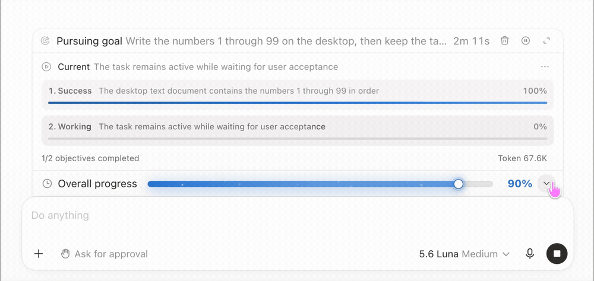
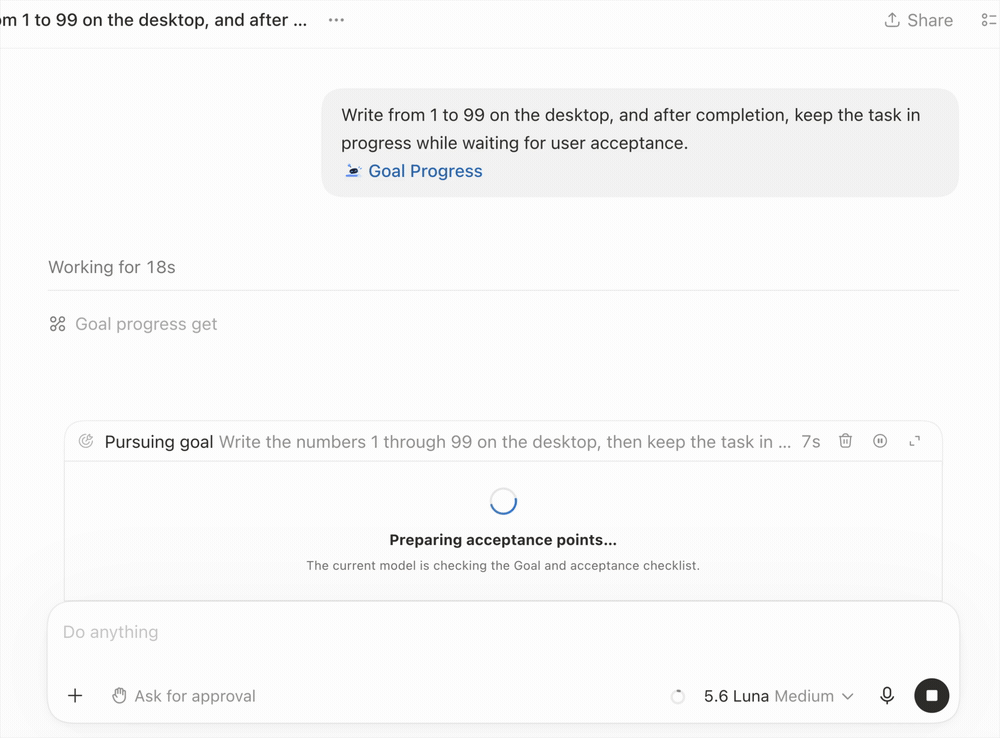
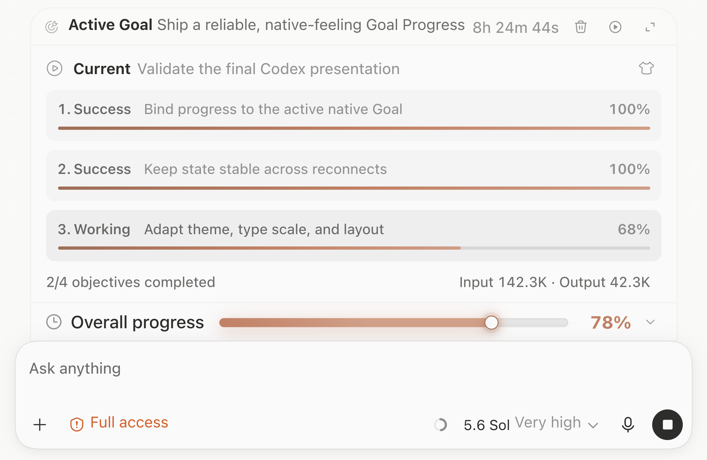
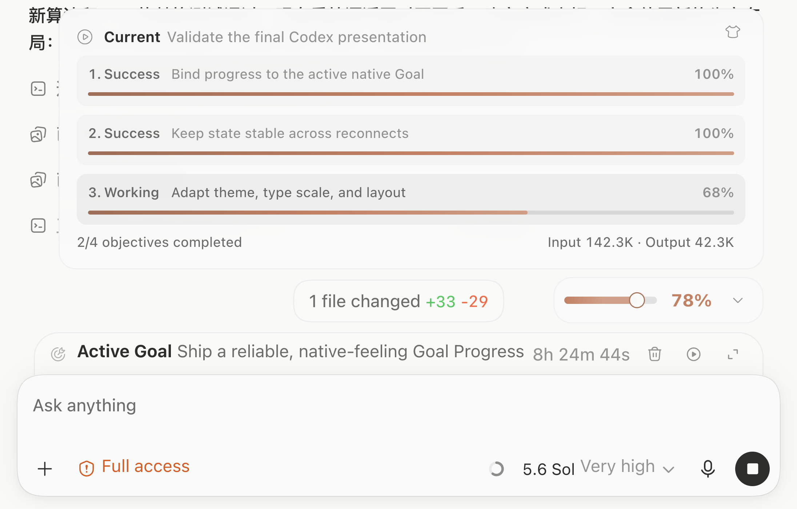
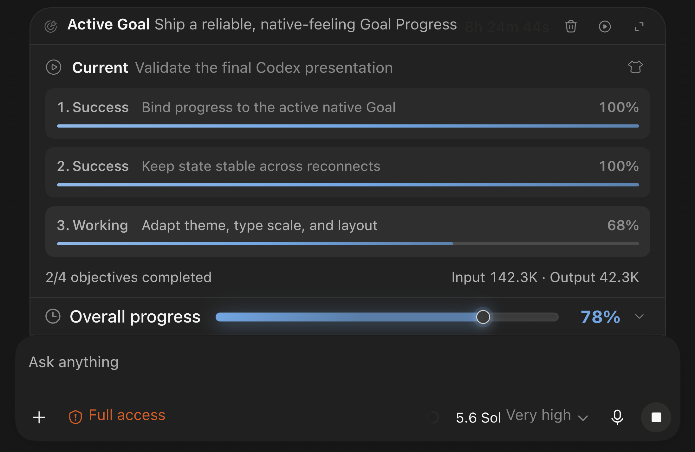
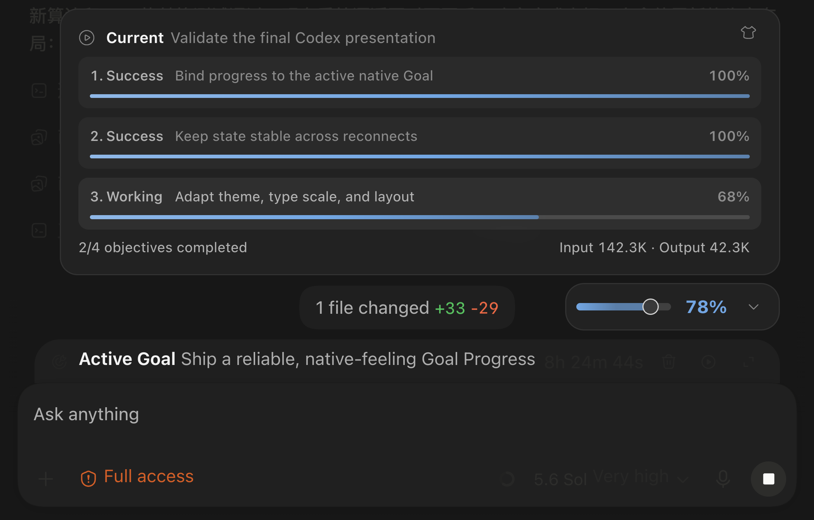
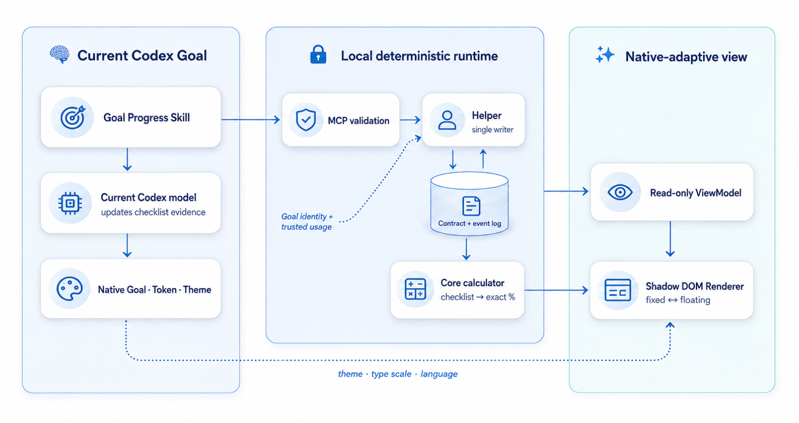

<div align="center">
  <h1 align="center">
    <br>
    Codex Goal Progress
  </h1>
  <p>为 Codex 原生 Goal 提供实时进度条，一眼看清已完成、进行中与下一步。</p>
  <p>
    <a href="https://github.com/Ezra-Y/codex-goal-progress/blob/main/README.md">English</a> ·
    <strong>简体中文</strong>
  </p>
</div>

<p align="center">
  
</p>

## ✨ 产品概览

Codex Goal Progress 在原生 Codex Goal 旁边显示实时进度卡片，帮助你直观跟进长时间任务的执行情况。

| 能力 | 体验 |
|---|---|
| 分步与总体进度 | 将目标拆分为清晰的步骤清单，同时展示当前步骤进度与总体完成度。 |
| 独立的耗时与 Token 指标 | 单独显示任务已用时间与归属于该 Goal 的 Token 用量，与完成百分比互不混算。 |
| 原生外观融合 | 自动跟随 Codex 浅色与深色主题、当前强调色及界面字号。 |
| 灵活显示位置 | 可固定停靠在原生 Goal 旁，也可切换为可自由拖动的漂浮卡片，并在多窗口间独立工作。 |
| 自动语言匹配 | 自动跟随当前 Codex 界面语言与文字方向。 |
| 持久保存进度与偏好 | 重新打开聊天或重启 Codex 后，自动恢复历史进度和显示设置。 |

## 🚀 快速开始

### 从插件市场安装

需要 Apple Silicon Mac、Codex Desktop、Node.js 22.12 或更高版本以及 pnpm 11。在 Codex 插件市场中安装 **Goal Progress**，首次启动时会自动完成本地初始化。

### 让 AI 安装

把下面这句话发给 AI：

```text
请按照仓库中的 INSTALL-FOR-AI.md，安装并验证 https://github.com/Ezra-Y/codex-goal-progress。
```

### 从终端一键安装

```bash
curl -fsSL https://github.com/Ezra-Y/codex-goal-progress/releases/latest/download/install.sh -o /tmp/codex-goal-progress-install.sh
sh /tmp/codex-goal-progress-install.sh
```

预构建 macOS 安装包自带运行时环境；如需重启 Codex，脚本会先征求你的确认。安装完成后，重新打开聊天或新建聊天即可加载插件。

## 🛠️ 环境要求

- Apple Silicon Mac
- Codex Desktop
- 仅插件市场源码版需要：Node.js 22.12 或更高版本，以及 pnpm 11（终端一键安装版已自带运行时）

## 🎯 如何使用

1. 在 Codex Desktop 中打开一个原生 Codex Goal。
2. 为该 Goal 选择 **Goal Progress** Skill。
3. 在 Goal 旁直接查看分步进度、总体完成度、耗时与 Token 用量，随时通过卡片右上角的 `⋯` 菜单切换显示方式或动效设置。

每个新 Goal 按需单独启用 Goal Progress；未启用的普通 Goal 保持 Codex 原生体验。

## 🌓 显示效果与主题

### 正在准备验收清单

<p align="center">
  
</p>

### 浅色

| 固定显示 | 漂浮显示 |
|---|---|
|  |  |

### 深色

| 固定显示 | 漂浮显示 |
|---|---|
|  |  |

## 🧭 工作原理

<p align="center">
  
</p>

Codex Goal Progress 完全在你的 Mac 本地运行。Codex 每推进一项工作就更新对应的步骤清单，本地服务据此计算分步与总体完成百分比，并在 Codex Desktop 界面内实时呈现进度卡片。

如需了解底层设计，请查看[技术架构](https://github.com/Ezra-Y/codex-goal-progress/blob/main/docs/ARCHITECTURE.md)、[权限范围](https://github.com/Ezra-Y/codex-goal-progress/blob/main/docs/PERMISSIONS.md)和[支持说明](https://github.com/Ezra-Y/codex-goal-progress/blob/main/docs/SUPPORT.md)。

## 🔄 更新与卸载

- **终端预构建版：** 直接在进度卡片的 `⋯` 菜单中检查并一键更新，或重新运行终端安装命令。
- **插件市场版：** 在 `⋯` 菜单中查看新版本说明后通过 Codex 插件市场更新；需要卸载时，直接对 Codex 说“卸载 Goal Progress”即可。

## 🔐 隐私说明

所有步骤清单、历史进度和显示偏好均保存在你的 Mac 本地，无外部云端服务。完整权限范围与卸载清理方式请查看 [PERMISSIONS.md](https://github.com/Ezra-Y/codex-goal-progress/blob/main/docs/PERMISSIONS.md)。

## 许可证

[MIT](https://github.com/Ezra-Y/codex-goal-progress/blob/main/LICENSE)
